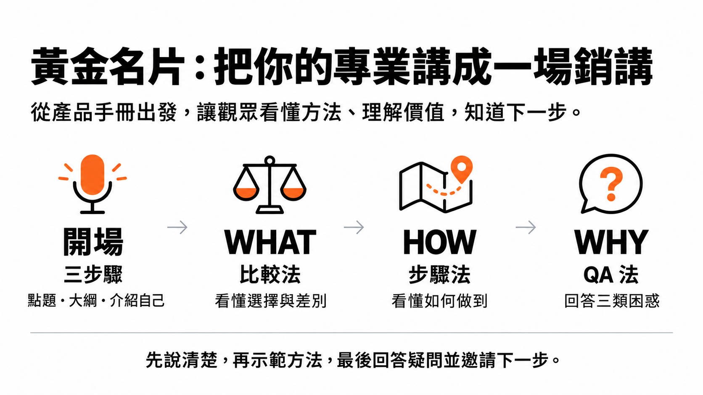
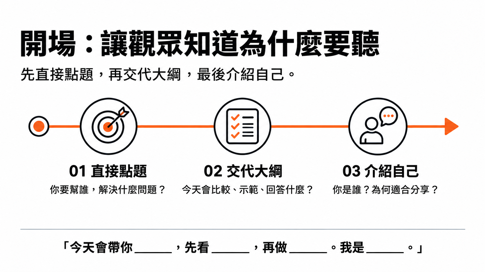
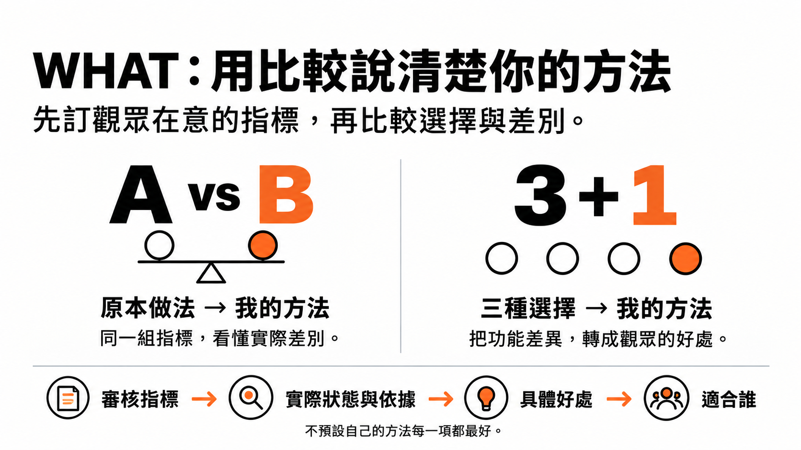
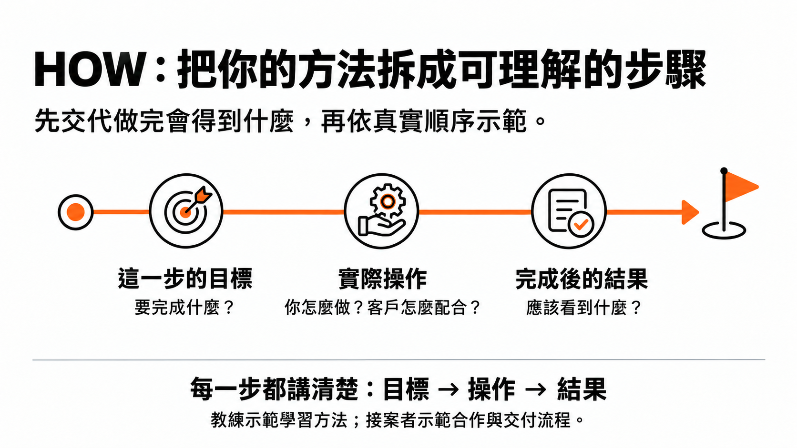
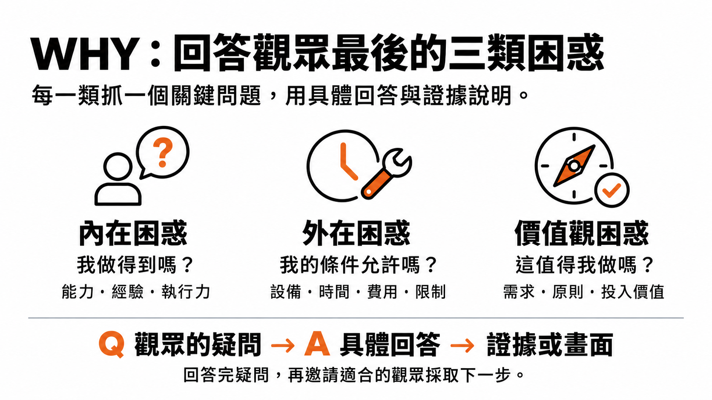

# 黃金名片銷講教練｜學員入口

用自己的產品資料，做出一份有比較依據、能說清楚服務的銷講。



**[下載完整學員安裝包](../downloads/golden-business-card-sales-talk-v1.zip?raw=true)** · [下載五張圖解](../downloads/golden-business-card-diagrams-v1.zip?raw=true) · [Skill 原始檔](../skills/golden-business-card-sales-talk/SKILL.md)

## 直接交給 Codex 安裝

把本頁連結與下面這段話貼給 Codex：

> 請從 https://github.com/Jaycheng1103/ai-superbrain-skills 安裝 skills/golden-business-card-sales-talk。先保留我已有的同名客製內容，再安裝完整資料夾；完成後讀回 SKILL.md 與 references，告訴我安裝位置。接著根據我提供的產品手冊，用 Tavily 研究競品，做一份銷講大綱及完整逐字稿。

有 Node.js 的學員也可以在自己的專案資料夾執行，只安裝這一支 skill：

```sh
npx skills add Jaycheng1103/ai-superbrain-skills --skill golden-business-card-sales-talk --agent codex --full-depth -y
```

這個指令安裝到目前專案。要安裝到全域、或沒有 Node.js，下載 ZIP 後按下面方式使用 Python 安裝。

提供自己的產品手冊、服務介紹或方案資料，AI 會整理重點、研究競品，按照以下模板製作銷講大綱，並可展開成完整口語逐字稿：

**開場三步驟 → WHAT 比較法 → HOW 步驟法 → WHY 三類 QA**

適合教練、顧問、接案、代操、房仲、保險、商品與其他行業。沒有課程也能使用。這裡的黃金名片是一份幫觀眾理解你的服務、判斷是否適合、知道下一步的銷講，不是紙本名片設計。

## 安裝

完整解壓 ZIP，在安裝包資料夾開啟終端機：

```sh
python3 install.py --platform codex
```

Windows 可改用 `py install.py --platform codex`。Claude Code 使用 `python3 install.py --platform claude`。安裝工具需要 Python 3.10 以上，不會覆寫同名版本。已有客製內容時先備份；也可把資料夾交給 Codex，請它保留舊版後安裝。

安裝後重新開啟工作階段。Skill 本身是指引，沒有自己的付費 API 或帳號。安裝不會自動連接 Tavily 或 Google Drive。

## 開始使用

把產品資料交給 AI，再貼上：

> 請用 $golden-business-card-sales-talk，根據我提供的產品手冊，先整理主要方案與觀眾，使用我自己的 Tavily 研究至少五個相關競品。依「開場三步驟 → WHAT 比較法 → HOW 步驟法 → WHY 三類 QA」做銷講大綱，再展開成完整逐字稿。預計講 10 分鐘，最後邀請觀眾預約諮詢。請保留未知資料，不要替我編造價格、案例或保證。

把時長、使用場景與最後希望觀眾採取的行動換成自己的需求。只要大綱時改說「只做大綱，先不要逐字稿」。沒有完整產品手冊也可以先提供現有資料，AI 會補問關鍵缺口，不要求重新做整份問卷。

## Tavily 競品研究

請到 Codex 的「外掛程式」搜尋 Tavily，依畫面完成安裝或連接。使用自己的連線，不需要把 API key 貼在聊天中。

研究會依你的受眾、問題、市場與服務方式找至少五家不同業者，區分直接競品及相鄰參考，附官網來源、查閱日期和限制。資料不足時會如實說明；不會湊出五家不存在的競品。

台上的比較可以用 A vs B，或三種選擇加上你的方法。研究五家不等於影片要逐一介紹五家。比較用同一組指標，不預設你的方法每一項都最好。

## 你會拿到什麼

- 銷講大綱：四段重點、畫面、轉場與預估時間。
- 完整逐字稿：依要求產出，可朗讀的內容與必要畫面提示。
- 競品研究與證據：來源、比較依據與限制，作為內部參考。
- 製作備註與待補：缺資料、待拍畫面、需要你決定的事。

預設輸出可編輯 Markdown。需要 PDF 時請另外提出，AI 會依你的環境產檔並檢查；要上傳 Google Drive，需連接自己的帳號並指定目的資料夾。沒有檔案工具時只能交文字，不能保證每個聊天平台都能安裝或匯出。

AI 不會把內部競品研究自動混進對外銷講稿，也不會修改你的原產品手冊。方案改善建議需你採納後才寫入新版。稿件有待補事項時，錄製前先完成；預估時長需實際試讀校正。

## 五張圖解

安裝包的「圖解」資料夾包含總覽、開場、WHAT、HOW、WHY 五張圖。這些是模板教學圖，不會因安裝自動變成你的銷講簡報。

原框架沿用教學模板的順序；銷講版在 WHY 收尾加入下一步邀請，講者姓名與身分採用學員自己提供的內容。

## 四段分解圖

### 開場三步驟



### WHAT 比較法



### HOW 步驟法



### WHY 三類 QA


